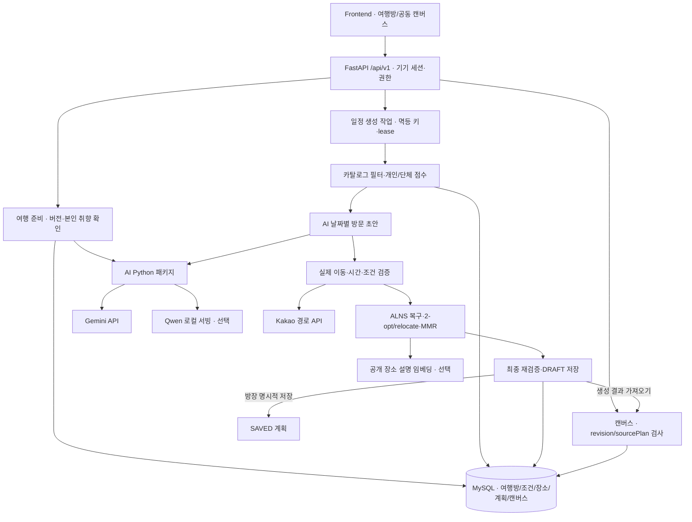

# 충북 여행 계획 · Backend

여행방의 조건과 개인 취향을 관리하고, 장소 후보 선정부터 일정 생성·검증·공동 편집까지 연결하는 **FastAPI/MySQL 백엔드**입니다.

## 프로젝트 개요

충북 단체여행에서 공통 조건과 각자의 선호를 모아 여행 코스를 만들고, 참여자가 함께 수정할 수 있도록 합니다. 이 저장소는 기기 인증·권한·버전·저장을 담당하고, 별도 AI 패키지의 제안을 실제 장소 데이터와 경로로 검증합니다.

### 주요 기능

| 기능 | 구현 범위 |
| --- | --- |
| 여행방 시작 | 기기 쿠키 세션, 방 생성, 초대 코드 참여, 재접속 |
| 여행 준비 | 공통 조건, 본인 원문·취향·예약/약속, AI 해석, 직접 확정, 조건/취향 버전 검사 |
| 일정 생성 | 장소 필터·개인/단체 점수, AI 날짜별 초안, 실제 이동·시간·요금 검증, 제한된 최적화 |
| 계획 저장 | 생성 작업 상태·멱등 처리, 오래된 입력 차단, 방장의 명시적 저장 |
| 공동 캔버스 | 생성 결과 가져오기, 장소·댓글·배치·연결 저장, 장소 검색·상세·단일 장소 AI 추천 |

개인 원문·해석 근거·개인 일정·개인 점수는 방장에게도 공개하지 않습니다. 방장이 공통 일정으로 확정한 예약/약속만 그룹 코스의 고정 기준점이 됩니다. 실제 장소 키는 현재 카탈로그의 `contentid INT`를 사용합니다.

### 저장소 역할

| 저장소 | 담당 |
| --- | --- |
| [FE](https://github.com/woowangthon/WOOWANGTHON_TEAM_17_FE) | 여행방·취향 확인·생성 진행·공동 캔버스 UI |
| **이 저장소 · BE** | 인증·권한·트랜잭션, 장소/경로 검증, 일정 최적화·저장 |
| [AI](https://github.com/woowangthon/WOOWANGTHON_TEAM_17_AI) | Gemini/Qwen 취향 해석, 후보 기반 일정 초안, 학습·평가 |

## 기술 설계 및 선택 (ADR)

현재 코드와 기능별 설계 문서를 기준으로 선택·근거·제약을 요약합니다.

| ADR | 선택 | 이유와 트레이드오프 |
| --- | --- | --- |
| BE-01 · API | Python 3.12+ / FastAPI / Uvicorn | FE에 HTTP API와 OpenAPI 문서를 제공합니다. 동기 DB·제공자 처리는 스레드풀로 분리하며, 현재 요청 제한·작업 실행은 단일 worker 기준입니다. |
| BE-02 · DB | MySQL 8 / SQLAlchemy Core / PyMySQL / 명시적 SQL migration | 기존 스키마의 FK·CHECK·생성 컬럼과 트랜잭션 경계를 보존합니다. 앱 시작 시 테이블을 자동 생성하지 않으므로 기존 업무 스키마와 기능별 migration을 별도로 준비해야 합니다. |
| BE-03 · 인증과 개인 정보 | 서버 발급 기기 쿠키 + 여행방/참여자 권한 검사 | 회원가입 없이 방을 시작하며 서버에서 OWNER/MEMBER·ACTIVE·OPEN을 검사합니다. 기기 쿠키가 식별 기준이므로 다른 브라우저는 별도 기기입니다. 화면에서 숨기는 것만으로 권한을 대신하지 않습니다. |
| BE-04 · 외부 호출과 저장 | 버전·digest·lease·멱등 키 | AI/경로 호출 중에는 DB 트랜잭션을 열어두지 않습니다. 저장 시 권한·입력 버전·카탈로그·lease를 다시 확인해 오래된 결과를 차단합니다. 중단된 유료 호출을 무조건 재시도하지 않습니다. |
| BE-05 · AI 역할 | Python 패키지로 제안 수신, BE에서 독립 검증 | AI는 취향과 방문 순서 초안을 제안합니다. 후보 ID·허용 날짜·필수 조건·실제 경로·시간·저장은 BE가 검사합니다. 자연어 해석이나 전체 예산 충족이 자동 보장되지는 않습니다. |
| BE-06 · 최적화 | ALNS 복구 + 2-opt/relocate·TOPTW 참고 탐색 + 임베딩/MMR | 제한된 시간·경로 조회 안에서 방문 축소와 장소 중복을 줄입니다. 임베딩은 공개 장소 설명만 사용하며 실패 시 기존 카테고리 점수로 돌아갑니다. 전역 최적해나 사용자 만족도를 증명하는 알고리즘은 아닙니다. |
| BE-07 · 공동 편집 | revision CAS + sourcePlan 경계 + 멱등 응답 | 새 생성 결과를 가져온 뒤 이전 문서가 덮어쓰지 못하게 합니다. 같은 생성 버전 재열기는 편집을 유지하지만, 새 버전 최초 가져오기는 캔버스 전체를 교체합니다. |
| BE-08 · 불확실성 | `verified` / `unknown` / 위반 구분 | 실제 응답과 명확한 원문만 검증 근거로 사용합니다. 미확인 비용·영업시간·경로를 0원·운영 중·이동 가능으로 처리하지 않습니다. 알려진 필수 위반은 사용자 동의로 정상 저장할 수 없습니다. |

## 아키텍처 다이어그램



생성 결과의 **공동 캔버스 가져오기**와 **정식 계획 저장**은 별도 동작입니다. 새 기본 FE 흐름은 준비 → 생성 → 공동 캔버스이며, 별도의 태그 재검토를 필수 단계로 두지 않습니다.

## 실행 방법

명령은 Windows PowerShell과 BE 저장소 루트를 기준으로 합니다.

### 1. 사전 준비와 설치

- Python **3.12 이상**, MySQL **8.0.16 이상**이 필요합니다.
- FE·BE·AI 저장소를 같은 부모 폴더에 둡니다. AI는 BE 가상환경에 설치하는 패키지이며, Qwen/ensemble 사용 시에만 별도 Qwen 서비스가 필요합니다.
- 기존 업무 스키마와 충북 장소 데이터가 준비된 DB가 필요합니다. 이 저장소의 migration만 빈 DB에 적용해서 전체 업무 DB를 만드는 구조는 아닙니다.

```powershell
py -3.12 -m venv .venv
.\.venv\Scripts\python.exe -m pip install -r requirements.txt
.\.venv\Scripts\python.exe -m pip install -e ..\WOOWANGTHON_TEAM_17_AI
if (-not (Test-Path .env)) { Copy-Item .env.example .env }
```

BE 의존성을 고정해서 재현하려면 `requirements.txt` 대신 `requirements.lock`을 설치한 뒤 `pip install -e ".[test]" --no-deps`를 실행합니다. 패키지 정의는 [pyproject.toml](pyproject.toml)을 참고합니다.

### 2. 환경변수

BE `.env`의 빈 항목을 로컬 값으로 채웁니다.

| 위치 | 설정 | 용도 |
| --- | --- | --- |
| BE `.env` | `DB_HOST`, `DB_PORT`, `DB_USERNAME`, `DB_PASSWORD`, `DB_NAME` | 기존 MySQL 연결. `DB_PORT` 기본값 3306, 현재 개발 대상 이름은 `chungbuk_trip1`입니다. |
| BE `.env` | `CURSOR_SIGNING_KEY` | 32자 이상의 개인 난수 값 |
| BE `.env` | `ENVIRONMENT=development`, `LOCAL_HTTP_COOKIE=true` | 로컬 HTTP 확인용 설정 |
| BE `.env` | `ALLOWED_ORIGINS` | `http://127.0.0.1:5173`, `http://127.0.0.1:8000`, `http://127.0.0.1:8017` 등 실제 접속 Origin |
| BE `.env` | `KAKAO_REST_API_KEY` | 서버의 실제 경로 조회 |
| AI 루트 `.env` 또는 프로세스 환경 | `GEMINI_API_KEY`, `GEMINI_MODEL` | Gemini 설정. 코드 기본 모델은 `gemini-3.5-flash-lite`입니다. |
| BE `.env` | `PREFERENCE_AI_PROVIDER=ensemble`, `QWEN_PREFERENCE_URL=http://127.0.0.1:18117/v1/interpret` | v2 취향 분석에서 두 모델을 사용할 때 명시적으로 추가. Qwen 서비스와 가중치 준비 필요 |
| BE `.env` | `PREFERENCE_AI_STRICT=true` | 선택 사항. ensemble의 일부 제공자 실패도 오류로 처리. 기본은 `false` |
| FE `.env.local` | `VITE_KAKAO_JAVASCRIPT_KEY` | 브라우저 지도 전용. 서버 키와 분리 |

`DB_*` 대신 `DATABASE_URL=mysql+pymysql://...`을 사용할 수 있습니다. 같은 원본에서는 `DATABASE_URL`이 우선이며 특수문자가 있는 비밀번호는 URL 인코딩이 필요합니다. `DB_*`를 사용하면 URL을 직접 조합할 필요가 없습니다.

`run.py`·DB 점검 CLI는 **OS DATABASE_URL → 완전한 OS DB_* → BE .env DATABASE_URL → BE .env DB_*** 순으로 선택합니다. 일부 OS `DB_*`만 있으면 오류입니다. Uvicorn `--env-file` 실행은 병합된 환경에서 URL이 우선하므로 DB 설정 방식을 하나로 맞춥니다.

Gemini 설정 로더는 AI 루트 `.env`만 읽고 프로세스 환경을 우선합니다. AI `.env` 전체가 BE 환경으로 주입되지는 않으므로 provider/URL 선택은 **BE `.env`**에 둡니다. 선택값 미지정 시 v2 함수의 provider 기본값은 `gemini`입니다.

### 3. DB 준비

[DB 구현 기준](docs/database-schema.md)과 [실제 장소 카탈로그 구조](docs/place-catalog-schema.md)를 확인한 뒤, 해당 기능에 필요한 migration을 관리자가 순서대로 적용합니다. 적용 여부는 각 환경에서 확인해야 합니다.

| Migration | 기능 |
| --- | --- |
| [001_device_entry](migrations/001_device_entry.up.sql) | 기기 세션·여행방 시작 지원 |
| [002_preparation](migrations/002_preparation.up.sql) | 여행 준비·개인 취향·AI 요청 |
| [003_generation](migrations/003_generation.up.sql) | 생성 설정·작업·호환용 개인 리뷰 |
| [004_canvas](migrations/004_canvas.up.sql) | 공동 캔버스 문서·요청 |
| [005_canvas_v4](migrations/005_canvas_v4.up.sql) | 캔버스 schema v4 저장 허용 |

앱 시작·`run.py`·import는 DDL을 실행하지 않습니다. 원본 dump 복원·공용 DB 초기화는 실행 절차에 포함하지 않습니다. 각 migration에는 대응하는 `.down.sql`이 있지만, 지원 테이블 제거가 기존 계획 데이터까지 복원하는 것은 아닙니다.

연결만 읽기 전용으로 점검하려면 다음을 실행합니다. 성공 메시지는 `Database connection successful`이며, 스키마·데이터 준비까지 확인한 것은 아닙니다.

```powershell
.\.venv\Scripts\python.exe -m app.check_db
```

### 4-A. FE 개발용 API 서버

```powershell
.\.venv\Scripts\python.exe -m uvicorn app.main:app --env-file .env --host 127.0.0.1 --port 8000 --workers 1
```

[API 문서](http://127.0.0.1:8000/docs)를 확인하고, FE에서 `npm run dev`로 [5173 화면](http://127.0.0.1:5173/)을 엽니다. 이 방식은 FE 정적 파일을 제공하지 않습니다.

### 4-B. 화면과 API를 한 서버에서 확인

FE 저장소에서 `npm ci`, `npm run build`를 실행한 다음 BE 루트로 돌아와 실행합니다.

```powershell
.\.venv\Scripts\python.exe run.py
```

[통합 화면](http://127.0.0.1:8017/)과 [API 문서](http://127.0.0.1:8017/docs)를 사용합니다. PyCharm에서도 BE `.venv`를 인터프리터로 선택해 `run.py`를 실행합니다. 기본 화면 경로는 `../WOOWANGTHON_TEAM_17_FE/dist`이며 `FRONTEND_DIR`로 변경할 수 있습니다. 자세한 조건은 [로컬 실행 안내](docs/local-review.md)를 참고합니다.

## 확인 방법

### 외부 제공자·공용 DB 없이 검사

```powershell
.\.venv\Scripts\python.exe -m pytest -q -m "not mysql"
```

기존 테스트는 HTTP TestClient·가짜 제공자·격리 fixture를 사용합니다. 단위 검사 통과는 실제 Gemini/Qwen·Kakao·MySQL 통합 성공과 별개입니다. BE에 별도 lint/typecheck 명령은 등록되어 있지 않습니다.

### 전용 MySQL 통합 검사

테스트 fixture는 **`127.0.0.1:3317/osami_entry_test`**만 허용합니다. 이 주소에 전용 테스트 DB를 준비하고 `TEST_DATABASE_URL`을 설정한 경우에만 실행합니다. 테스트는 전용 테이블을 생성·정리하므로 공용 개발 DB를 지정하지 않습니다.

```powershell
.\.venv\Scripts\python.exe -m pytest -q tests
```

전용 환경이 없으면 MySQL 검사는 skip되며 전체 통합 검증을 마쳤다고 볼 수 없습니다. 준비 도구·절차는 [여행방 구현](docs/trip-entry-implementation.md)과 [일정 생성 구현](docs/generation-implementation.md)을 참고합니다.

### 실제 기능 확인

1. FE에서 방을 만들고 다른 브라우저로 초대 참여합니다.
2. 공통 조건과 본인 취향을 저장·확인한 뒤, 방장의 일정 만들기를 실행합니다.
3. 생성 상태와 미확인 항목을 확인하고, 공동 캔버스에서 편집·새로고침 복원을 확인합니다.
4. 공통 조건이나 개인 취향을 바꿔 이전 결과가 최신 일정으로 저장되지 않는지 확인합니다.
5. 방장·일반 참여자의 권한, 다른 사람의 개인 원문 비공개, 동시 저장 충돌을 확인합니다.

실제 AI·경로 확인은 제공자 호출 비용이 발생할 수 있습니다. 알려진 필수 조건 위반과 미확인 상태를 구분해야 합니다. 자가용의 검증된 `PLACE → PLACE` 구간은 40분 상한을 적용하며, 출발/복귀 구간은 이 상한의 대상에서 제외합니다. 식사 권장 시간은 소프트 기준이고 확정 예약·실제 영업시간 검사는 유지합니다.

## 디렉터리 구조

```text
app/main.py, config.py                 앱·인증·공통 설정
app/preparation.py                    공통 준비·본인 취향·AI 해석
app/confirmed_*, preference_*          확정 조건·취향 구조화·매핑
app/candidate_selection.py             후보 필터·개인/단체 점수
app/generation_*.py                    생성 작업·정책·API
app/day_schedule.py, plan_validation.py 시간표·필수 조건 검증
app/alns_repair.py, itinerary_optimizer.py  제한된 복구·탐색
app/place_semantics.py                 장소 임베딩·MMR
app/routing.py                        실제 경로 조회·응답 검증
app/plan_store.py                      계획·버전 저장
app/canvas_*.py                        공동 캔버스·가져오기·추천
migrations/                           명시적 up/down SQL
tests/                                단위·전용 MySQL 통합 검사
scripts/                              전용 테스트 준비·평가 도구
run.py                                FE dist + API 로컬 실행
```

## 상세 문서

- 계약·권한: [API 계약](docs/api-contract.md), [여행 준비 구현](docs/preparation-implementation.md), [취향 분석 v2](docs/preference-ensemble.md)
- 생성·검증: [후보·AI 초안](docs/candidate-draft.md), [일정 생성·저장](docs/generation-implementation.md), [ALNS·임베딩/MMR](docs/generation-alns-mmr.md)
- 세부 정책: [도보 제한](docs/walking-preference-unification.md), [카테고리·자가용 제한](docs/category-diversity-car-limit.md), [식사 권장 시간](docs/soft-meal-preferences.md)
- 공동 편집: [공동 캔버스](docs/canvas-studio.md), [계획 가져오기와 교체 정책](docs/plan-canvas-import.md)
- DB·실행: [DB 기준](docs/database-schema.md), [장소 카탈로그](docs/place-catalog-schema.md), [로컬 검수](docs/local-review.md)
- 평가: [AI 품질 평가 방법](docs/ai-quality-evaluation.md), [평가 기록](docs/ai-quality-evaluation-results.md)
- 팀 작업: [AGENTS.md](AGENTS.md), [에이전트 운영](docs/orchestration.md), [GitHub 절차](docs/github-workflow.md), [첫 참여 안내](docs/codex-onboarding.md)

평가·검수 문서의 수치와 실행 기록은 각 문서의 날짜·환경·입력 범위에 한정됩니다. 합성 검사나 미확인 상태의 일정 반환을 실제 사용자 품질·전체 예산·최적해 보장으로 해석하지 않습니다.
